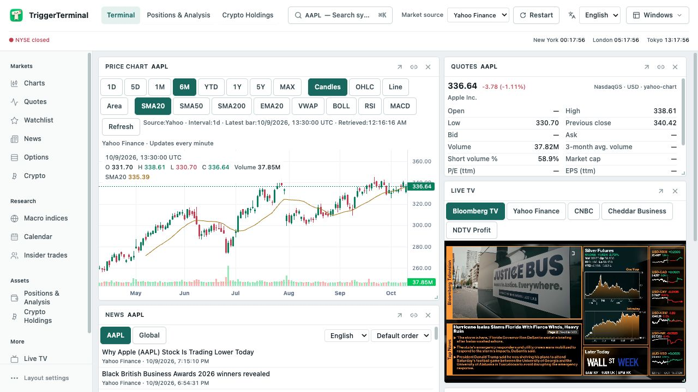
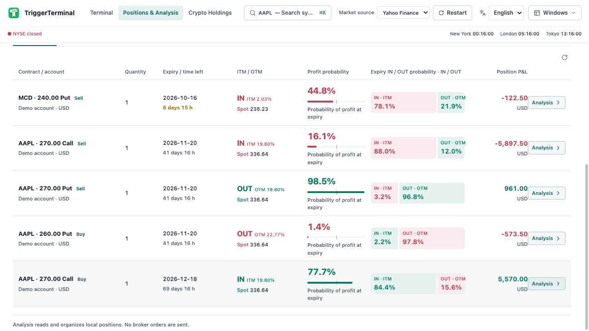
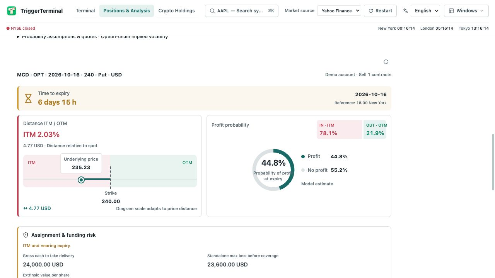

  

<h1 align="center">TriggerTerminal</h1>

<strong>Your portfolio. Your machine. A clearer view of options.</strong> Portfolio management · Options & strategy analysis · Read-only IBKR access

  
  
  
  

  <a href="#download">Download</a> &nbsp; · &nbsp; <a href="#features">Features</a> &nbsp; · &nbsp; <a href="#ibkr">Connect IBKR</a> &nbsp; · &nbsp; <a href="#data">Data & design</a>

<a href="README.md">简体中文</a> &nbsp; / &nbsp; <a href="README.en.md">English</a>

An open-source desktop workspace for investors who hold options. Bring accounts, currencies and asset types together to track costs, P&L, expiry dates and strategies. Account records stay on your computer; the IBKR connection reads data without placing orders.

| Local records | Options in focus | One workspace |
| :--- | :--- | :--- |
| Account and trade records on your machine. Read-only brokerage access. | Profit probability, per-leg ITM probability, expiry payoff and strategy recognition. | Multi-asset holdings, market charts, news and financial TV. |

## Download & get started

| Platform | Installer | Requirements |
| :--- | :--- | :--- |
| **Windows** | [Windows x64 · EXE](https://github.com/eztrigger/TriggerTerminal/releases/download/v0.1.0/TriggerTerminal-0.1.0-win-x64.exe) | 64-bit Windows |
| **macOS** | [Apple Silicon · DMG](https://github.com/eztrigger/TriggerTerminal/releases/download/v0.1.0/TriggerTerminal-0.1.0-mac-arm64.dmg) | macOS 14+ · Apple Silicon |

Node.js and Python are included. Run the Windows installer, or drag the macOS app into Applications. Start with a manual account, or connect IBKR using the steps below.

[ Release notes ](https://github.com/eztrigger/TriggerTerminal/releases/tag/v0.1.0) · [SHA256](https://github.com/eztrigger/TriggerTerminal/releases/download/v0.1.0/SHA256SUMS.txt) · [User guide](docs/USER_GUIDE.en.md)

Installers are not yet signed / notarized and may trigger an unverified-publisher warning. An Intel Mac installer is not currently available.

## Built around your positions

### Your holdings at a glance

Stocks, ETFs, funds, futures and options share a portfolio view, organized by asset class, account and currency. Add records manually or sync from your broker, with current positions and historical trades kept in separate views.

The list shows the essentials first; click a position to expand its analysis. For options, contracts, quantities, time to expiry, moneyness, probability of profit and P&L appear side by side.

*English interface with a separate demo account. No real account data is shown.*

### Options: price, probability and risk

**Profit probability and ITM probability are distinct.** Probability of profit uses your position's cost basis. IN / OUT describes the modeled probability of finishing in or out of the money. A short option can finish ITM and still make money because of the premium received.

**See where the price stands.** Spot and strike share a visual price axis, alongside an expiry countdown. Probability of profit has its own chart; ITM / OTM colors account for whether the option is bought or sold.

**Open the details when you need them.** Review cost, valuation, market value, maximum profit and loss, and breakeven prices. Assignment funding, remaining time value, bid–ask spreads and estimated closing P&L provide further context.

*A short put example, with profit probability and expiry IN / OUT shown separately.*

### From individual legs to strategies

Strategies are recognized automatically and can be adjusted manually. Positions in the same underlying can be grouped across accounts. Grouping does not change the actual holdings or imply that a broker permits collateral or margin offsets across accounts.

- **Single options:** probability of profit and breakeven use the position's actual cost basis.
- **Spreads:** analyze the combined payoff, retain each leg's ITM probability, and distinguish expiry scenarios where neither, one or both legs finish ITM.
- **Calendars:** estimates assume closing the entire position at the near-term expiry. The far leg retains time value and is valued using current implied volatility.

Probabilities use spot, strike, remaining time, implied volatility, interest rates and dividend assumptions. They are model estimates, not historical win rates or predictions of early assignment. Calendar estimates are particularly sensitive to volatility assumptions. Missing market data or required inputs should never be read as zero.

### A workspace you can arrange

Keep charts, quotes, watchlists, news and financial TV in the same workspace. Place a live broadcast beside your chart to follow market coverage while reviewing prices. Panels can be moved, resized or opened in separate windows.

Add **Live TV** from the sidebar and choose a channel. Playback starts muted; availability depends on the broadcaster, region and network.

## Local records. Read-only access.

Account, position and trade records stay on your computer. IBKR connects through a local Gateway / TWS session. The app reads account and market data; it does not place orders. Local bookkeeping does not change your brokerage account, and synced positions cannot be manually closed in the app.

Market queries still require internet access and send symbols or contracts to data providers. The app is intended for single-user local operation. Local databases are not encrypted, so protect your device and backups. See the [privacy notes](https://github.com/eztrigger/TriggerTerminal/blob/main/docs/PRIVACY.md).

IBKR is currently supported. Support for more brokers will be added over time.

## Connect IBKR Gateway / TWS

1. Download **IB Gateway** from the [official IBKR download page](https://www.interactivebrokers.com/docs/tws-api/doc/trader-workstation-and-ib-gateway/download-tws-or-ib-gateway) and sign in. **Trader Workstation (TWS)** is also supported through the same Socket API.
2. In Gateway, open **Configure → Settings → API → Settings**. In TWS, open **Global Configuration → API → Settings** and enable **Enable ActiveX and Socket Clients**. Gateway normally enables the Socket API by default.
3. Keep **Read-Only API** checked and allow local connections only. Check **Socket port**, then click Apply / OK.
4. In TriggerTerminal, open **Positions & analysis → Account management → IBKR**, enter that port and an unused Client ID, then load and sync the account. Keep Gateway / TWS signed in while using the connection.

| Application | Default live port | Default paper port |
| --- | --- | --- |
| IB Gateway | 4001 | 4002 |
| TWS | 7496 | 7497 |

Your configured Socket port takes precedence. Market data permissions depend on your IBKR subscriptions. Read-only access does not grant additional subscriptions. See [IBKR’s API configuration guide](https://www.interactivebrokers.com/campus/trading-lessons/installing-configuring-tws-for-the-api/).

## Data & design

<strong>Data sources, updates and quote status</strong>

| Data | Sources and use |
| --- | --- |
| Brokerage accounts, positions and trades | Local IBKR Gateway / TWS. Manual accounts use user-entered ledger records. |
| Quotes, price history and option chains | IBKR and Yahoo Finance, depending on the selected source and asset type. Options analysis prefers IBKR; Yahoo Finance can fill missing fields for eligible standard USD equity options. |
| Stock fundamentals and financial statements | Yahoo Finance and SEC EDGAR. Reporting dates, currencies and available fields affect analysis coverage. |
| Fund NAV | Supported TD funds use TD Asset Management's official pages, with checks for fund code, series currency and NAV date. Not all funds are supported. |
| Model interest rates and dividends | USD rates reference U.S. Treasury term rates. Dividend inputs use IBKR, Yahoo Finance or verified issuer information. |
| News | Yahoo Finance RSS, Google News aggregation and the original publishers they link to. |
| Financial TV | External streaming feeds for the selected channel. Video connects directly to the stream provider. |

Quotes may be live, delayed, frozen or the last available observation, depending on market hours, subscriptions and provider access. Fields can have different sources and timestamps. Use the displayed provenance, timestamps and missing-data status to check them; do not assume every number is live.

<strong>Interface and analysis design</strong>

- **Overview first, detail on demand.** Compact lists keep positions readable. Diagrams make price location and probabilities easier to compare; deeper analysis opens when needed.
- **Keep the basis clear.** P&L uses position cost. Strategy-level metrics stay distinct from individual-leg probabilities, and missing inputs remain visible.
- **Show cached data while updates arrive.** Analysis uses WebSocket updates, cached snapshots and shared in-flight requests. Returning to the page keeps the previous snapshot visible until fresh data arrives.
- **Separate management from execution.** Analysis helps explain a position; local bookkeeping does not replace a broker fill. Chinese and English interfaces share the same features and calculation logic.

## Documentation & feedback

[User guide](docs/USER_GUIDE.en.md) · [Privacy notes](docs/PRIVACY.md) · [Holdings ledger design](docs/HOLDINGS_LEDGER.md) · [Report an issue](https://github.com/eztrigger/TriggerTerminal/issues)

IBKR is supported today, with more brokers to follow. Use Issues for connection problems, missing data and feature suggestions. Pull requests are currently disabled.

## License & acknowledgments

Based on [OpenTerminal](https://github.com/ErTasselli/OpenTerminal), under the [MIT license](LICENSE). See [THIRD_PARTY_NOTICES.md](THIRD_PARTY_NOTICES.md) for third-party code and assets.
