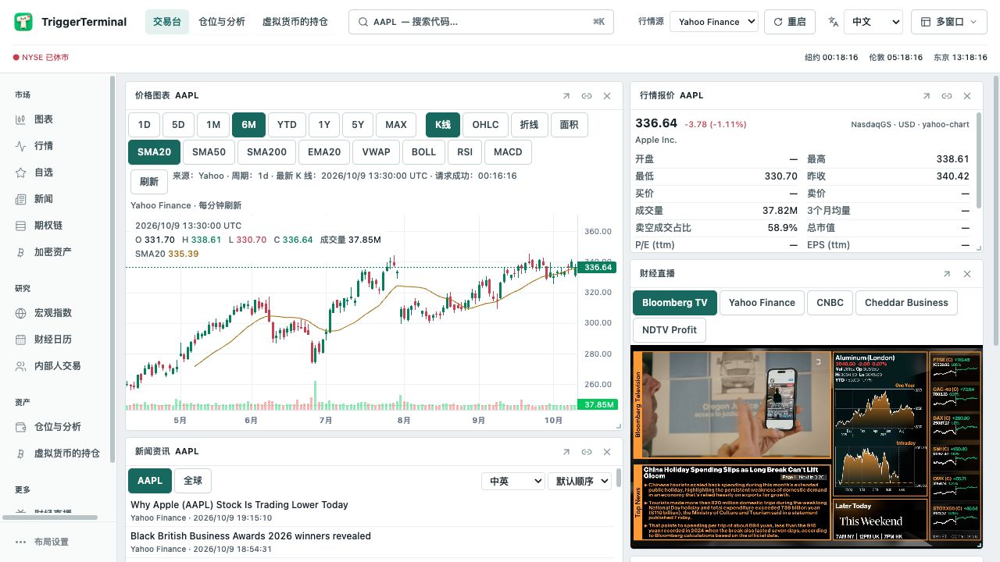
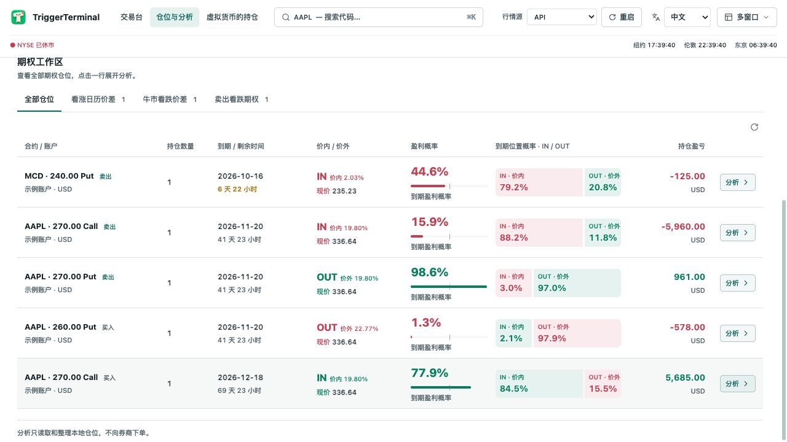
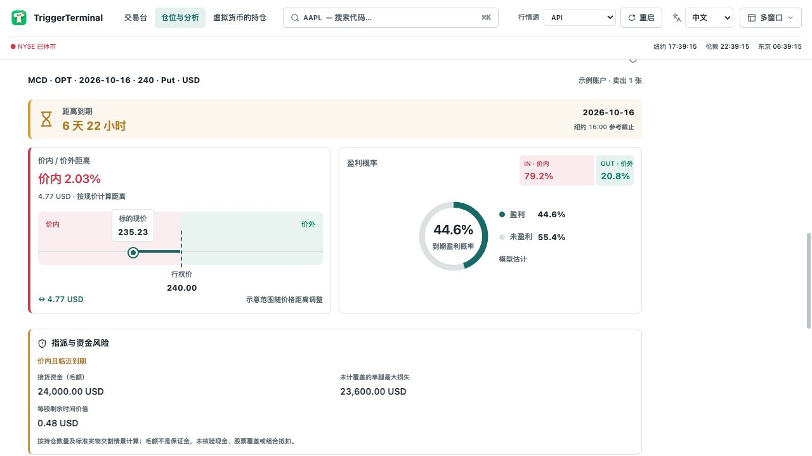

  

<h1 align="center">TriggerTerminal</h1>

<strong>在本机管理资产，看清期权持仓与策略。</strong> 多账户持仓管理 · 期权与策略分析 · 只读连接 IBKR

  
  
  
  

  <a href="#download">下载</a> &nbsp; · &nbsp; <a href="#features">功能</a> &nbsp; · &nbsp; <a href="#ibkr">连接 IBKR</a> &nbsp; · &nbsp; <a href="#data">数据与设计</a>

<a href="README.md">简体中文</a> &nbsp; / &nbsp; <a href="README.en.md">English</a>

一个面向期权持有者的开源桌面交易台。把不同账户、币种和资产放到同一个界面，查看成本、盈亏、到期时间与策略关系。账户记录保存在本机，IBKR 连接只读取数据，不向券商下单。

| 本地管理 | 期权分析 | 一个工作区 |
| :--- | :--- | :--- |
| 账户与交易记录保存在本机；券商连接只读。 | 盈利概率、逐腿价内概率、到期盈亏与策略识别。 | 多资产持仓、行情图表、新闻与财经电视。 |

## 下载与开始使用

| 平台 | 安装包 | 要求 |
| :--- | :--- | :--- |
| **Windows** | [Windows x64 · EXE](https://github.com/eztrigger/TriggerTerminal/releases/download/v0.1.0/TriggerTerminal-0.1.0-win-x64.exe) | 64 位 Windows |
| **macOS** | [Apple Silicon · DMG](https://github.com/eztrigger/TriggerTerminal/releases/download/v0.1.0/TriggerTerminal-0.1.0-mac-arm64.dmg) | macOS 14+ · Apple Silicon |

安装包自带 Node.js 和 Python。Windows 运行安装向导；macOS 拖入「应用程序」。打开后可先录入手动账户，或按下方步骤连接 IBKR。

[ 发布说明 ](https://github.com/eztrigger/TriggerTerminal/releases/tag/v0.1.0) · [SHA256](https://github.com/eztrigger/TriggerTerminal/releases/download/v0.1.0/SHA256SUMS.txt) · [使用指南](docs/USER_GUIDE.zh-CN.md)

当前安装包尚未签名／公证，系统可能提示来源未验证。macOS 暂不提供 Intel 安装包。

## 为持仓分析而设计

### 所有持仓，一处查看

股票、ETF、基金、期货和期权使用统一的持仓入口，按资产类别、账户和币种查看。支持手动录入与券商同步，当前仓位与历史成交分开管理。

列表先呈现决策需要的重点，详细分析点击后展开。期权列表把合约、数量、剩余期限、价内价外、盈利概率和持仓盈亏并排显示，避免来回切换页面。

*期权持仓总览。截图使用独立示例账户，不含真实账户资料。*

### 期权：价格、概率与风险

**盈利概率与价内概率分开看。** 盈利概率按持仓成本判断是否赚钱；IN / OUT 表示到期时处于价内或价外的模型概率。卖出期权即使到期价内，也可能因为已收取权利金而盈利，两者不能混用。

**价格位置直接画出来。** 现价与行权价放在同一条示意轴上，配合到期倒计时，快速看清离行权价还有多远。盈利概率用独立图示展示；红绿颜色结合买卖方向表达价内、价外的含义。

**展开后再看细节。** 成本、估值、市值、最大盈利、最大损失和盈亏平衡价集中呈现；指派资金需求、剩余时间价值、买卖价差和盘口平仓估算用于进一步检查风险。

*单腿卖出看跌期权示例。盈利概率与到期 IN / OUT 分别展示。*

### 从单腿到多腿策略

系统自动识别持仓策略，也允许手动调整。同一标的可以跨账户组合分析；归组不会改变真实账户中的仓位，也不代表券商认可跨账户的抵押或保证金抵扣。

- **单腿期权**：按实际持仓成本计算盈利概率与盈亏平衡价。
- **价差组合**：分析整个组合的到期盈亏，同时逐腿显示价内概率，并区分两腿价外、仅一腿价内和两腿价内的到期情形。
- **Calendar**：按近月到期时平掉整个组合估算，远月腿保留剩余时间价值，使用当前隐含波动率估值。

概率使用现价、行权价、剩余期限、隐含波动率、利率与股息假设计算，是模型估计，不是历史胜率，也不是实际提前指派概率。Calendar 对波动率假设尤其敏感；行情或必要参数不足时，不应把缺失值理解为零。

### 可自由布局的行情工作区

图表、行情报价、自选列表、新闻和财经电视可以放在同一工作区。把直播放在图表旁边，看行情时也能跟进市场报道；每个面板都可以拖动、调整大小或独立成窗。

从左侧选择 **财经直播**，再选择频道。默认静音播放，频道可用性取决于播出方、地区和网络。

## 本地记录，只读连接

账户、持仓和交易记录保存在本机。IBKR 通过本地 Gateway / TWS 连接；应用读取账户和行情，不向券商下单。本地记账不会改变券商账户，API 同步的仓位也不能在应用里手动平仓。

行情查询仍需联网，会向数据源发送标的或合约信息。应用面向单用户本地运行，本地数据库未加密，应保护电脑和备份。详见[隐私说明](https://github.com/eztrigger/TriggerTerminal/blob/main/docs/PRIVACY.md)。

目前支持 IBKR，后续将陆续推出对更多券商的支持。

## 连接 IBKR Gateway / TWS

1. 从 [IBKR 官方下载页](https://www.interactivebrokers.com/docs/tws-api/doc/trader-workstation-and-ib-gateway/download-tws-or-ib-gateway) 下载 **IB Gateway** 并登录。也支持 **Trader Workstation（TWS）**，两者使用相同的 Socket API。
2. Gateway 打开 **Configure → Settings → API → Settings**；TWS 打开 **Global Configuration → API → Settings**。在 TWS 勾选 **Enable ActiveX and Socket Clients**；Gateway 通常默认启用 Socket API。
3. 保持 **Read-Only API** 勾选，仅允许本机连接。核对 **Socket port**，点击 Apply / OK。
4. 在 TriggerTerminal 的「仓位与分析 → 账户管理 → IBKR」填写相同端口及未被其他程序占用的 Client ID，读取账户并同步。使用期间保持 Gateway / TWS 登录。

| 程序 | 实盘默认端口 | 模拟默认端口 |
| --- | --- | --- |
| IB Gateway | 4001 | 4002 |
| TWS | 7496 | 7497 |

以你的 Socket port 设置为准。行情权限由 IBKR 账户订阅决定；只读连接不会获得额外行情权限。详见 [IBKR 官方 API 配置说明](https://www.interactivebrokers.com/campus/trading-lessons/installing-configuring-tws-for-the-api/)。

## 数据与设计

<strong>数据来源、更新频率与行情状态</strong>

| 数据 | 来源与用途 |
| --- | --- |
| 券商账户、持仓与成交 | 本地 IBKR Gateway / TWS；手动账户使用用户录入的账本记录。 |
| 报价、历史价格与期权链 | 支持 IBKR 与 Yahoo Finance，具体路径取决于行情源和资产类型。期权分析优先使用 IBKR；符合条件的标准美元股票期权可由 Yahoo Finance 补充缺失字段。 |
| 股票基本面与财务数据 | Yahoo Finance 与 SEC EDGAR；财报日期、币种及可用字段会影响分析覆盖度。 |
| 基金净值 | 已适配的 TD 基金从 TD Asset Management 官方页面读取，校验基金代码、系列币种与净值日期；并非所有基金都已支持。 |
| 期权模型的利率与股息 | 美元利率参考美国财政部期限利率；股息参考 IBKR、Yahoo Finance 或已核对的发行人资料。 |
| 新闻 | Yahoo Finance RSS、Google News 聚合及其链接的原始媒体。 |
| 财经电视 | 所选频道的外部直播流，视频直接连接对应的流媒体服务。 |

行情可能是实时、延迟、冻结或最近一次可用数据，取决于市场状态、订阅权限与供应商。不同字段可能来自不同时间和来源；界面提供的来源、时间与缺失状态用于核对，不应把所有数字都当成实时行情。

<strong>界面与分析的设计思路</strong>

- **先看全局，再展开细节。** 列表保持紧凑，图示突出价格位置与概率，深入分析按需打开。
- **保留计算依据。** 盈亏始终以持仓成本为基准；组合指标与单腿概率分开，数据不足时显示缺失。
- **先显示已有数据，再后台更新。** 分析通过 WebSocket 获取更新，复用缓存和正在进行的请求；再次打开时先保留上次快照，新数据到达后再替换，减少白屏等待。
- **管理与交易分开。** 分析帮助理解持仓，本地操作不替代券商成交。中英文界面使用同一套功能与计算逻辑。

## 文档与反馈

[使用指南](docs/USER_GUIDE.zh-CN.md) · [隐私说明](docs/PRIVACY.md) · [持仓账本设计](docs/HOLDINGS_LEDGER.md) · [问题反馈](https://github.com/eztrigger/TriggerTerminal/issues)

目前支持 IBKR，后续将陆续加入更多券商。欢迎通过 Issues 反馈连接问题、数据缺失和功能建议；当前不接受 PR。

## 许可与致谢

基于 [OpenTerminal](https://github.com/ErTasselli/OpenTerminal)，采用 [MIT 许可证](LICENSE)。第三方代码与资源见 [THIRD_PARTY_NOTICES.md](THIRD_PARTY_NOTICES.md)。
